<picture>
  <source media="(prefers-color-scheme: dark)" srcset="dark.svg">
  <source media="(prefers-color-scheme: light)" srcset="light.svg">
  
</picture>

 

 

### 🚀 About Me

- 🎓 Final-year student at **LNMIIT Jaipur**
- 💻 Building full-stack, blockchain & AI-powered projects
- 🌱 Currently exploring **Web3 / RWA tokenization** and **modern JS frameworks**
- 📍 Based in Jaipur, Rajasthan, India
- ⚡ Fun fact: I like turning weekend ideas into shipped repos

 

### 🛠️ Tech Stack

  

 

### 📊 GitHub Stats

  
  

  

 

### 📌 Featured Projects

| Project | Description |
|---|---|
| [**AssetFlow_HAAS**](https://github.com/amartya1523/AssetFlow_HAAS) | Enterprise asset & resource management system with real-time visibility and audit workflows |
| [**RWA-Real-Estate-Mantra-Chain**](https://github.com/amartya1523/RWA-Real-Estate-Mantra-Chain) | Real-world asset tokenization on Mantra Chain |
| [**CHATBOT**](https://github.com/amartya1523/CHATBOT) | Conversational chatbot project |
| [**Spotify-Clone**](https://github.com/amartya1523/Spotify-Clone) | Spotify UI clone built with HTML/CSS |

 

### 🤝 Connect With Me

  
  

  Built with ❤️ — pure SVG hero banner, no JS required.

