<div align="center">

<a href="https://www.amartyasingh.space/">
  
</a>


<a href="https://www.amartyasingh.space/"></a>
<a href="https://www.linkedin.com/in/amartya-vikram-singh-4a6485253/"></a>
<a href="https://twitter.com/Amartya1523"></a>
<a href="https://github.com/amartya1523"></a>

</div>

<br/>



<br/>

## 👾 Boss Levels: things I built from scratch

| | Level | What it is | Loot |
|:-:|---|---|---|
| 🛰️ | **[ShadowNet](https://github.com/amartya1523/ShadowNet)** | An internet simulator with 100,000 nodes. OSPF, RIP and BGP written from scratch, plus a reinforcement-learning router. Cut cables, crash routers, launch a botnet and watch the network heal. | `Rust` `TimescaleDB` `Redis` `Next.js` |
| 🧬 | **[SyncForge](https://github.com/amartya1523/SyncForge)** | A real-time collaboration engine built on a hand-written sequence CRDT (no Yjs, no Automerge). Shared editor, version time-travel and a multiplayer whiteboard, fuzz-tested for convergence. | `TypeScript` `CRDT` `Postgres` `Redis` |
| 🚨 | **[CodePulse](https://github.com/amartya1523/CodePulse)** | An AI incident platform. OpenTelemetry pipeline, anomaly detection, trace-based root-cause analysis, an AI investigator that cites its evidence, and auto-remediation with rollback. | `TypeScript` `OpenTelemetry` `LLMs` |
| 👻 | **[GhostOS](https://github.com/amartya1523/GhostOS)** | An AI agent that operates a computer the way a person does. | `Python` `Agents` `Vision` |
| 📚 | **[DocsHealer](https://github.com/amartya1523/DocsHealer)** | Keeps technical documentation in sync with the codebase automatically. | `TypeScript` `AI` |
| 🏢 | **[AssetFlow](https://github.com/amartya1523/AssetFlow_HAAS)** | Enterprise asset management with conflict-free booking and audit workflows. [▶ Play live](https://asset-flow-haas.vercel.app) | `JavaScript` `Node` |

<br/>

## 🎮 Inventory

<p align="center">
  <br/>
  <br/>
  <br/>
  
</p>

<br/>

## 🕹️ Now Playing: Pac-Man vs. my contribution graph

<p align="center">
  <picture>
    <source media="(prefers-color-scheme: dark)" srcset="https://raw.githubusercontent.com/amartya1523/amartya1523/output/pacman-contribution-graph-dark.svg"/>
    <source media="(prefers-color-scheme: light)" srcset="https://raw.githubusercontent.com/amartya1523/amartya1523/output/pacman-contribution-graph.svg"/>
    
  </picture>
</p>

<details>
<summary><b>🐍 Insert another coin: Snake mode</b></summary>
<br/>
<p align="center">
  <picture>
    <source media="(prefers-color-scheme: dark)" srcset="https://raw.githubusercontent.com/amartya1523/amartya1523/output/github-snake-dark.svg"/>
    <source media="(prefers-color-scheme: light)" srcset="https://raw.githubusercontent.com/amartya1523/amartya1523/output/github-snake.svg"/>
    
  </picture>
</p>
</details>

<br/>

## 🏆 High Scores

<p align="center">
  
  
</p>

<br/>

<div align="center">

```text
> GAME OVER? NAH. RESPAWNING WITH ANOTHER SIDE PROJECT...
> INSERT COIN: SAY HI ON LINKEDIN OR X_
```

<sub>Pac-Man &amp; Snake refresh every 12 hours from my real contributions via GitHub Actions.</sub>

</div>
